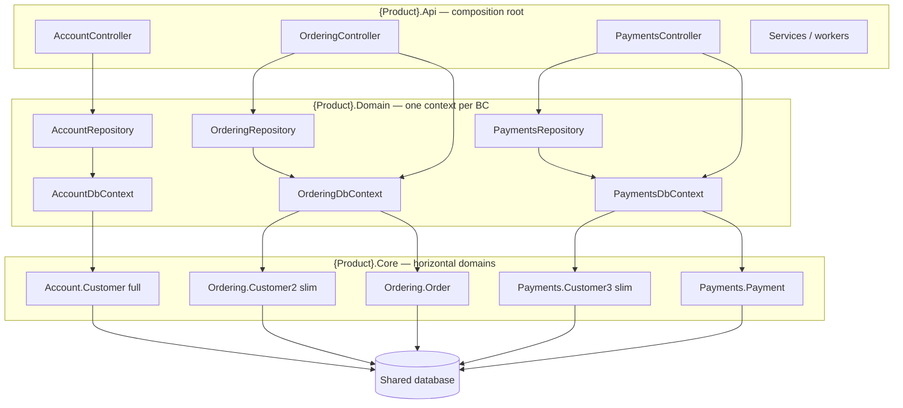

# Arc's DDD (Australian DDD) — Architecture Playbook

> Author: **Arc (Arda Akgur)** — pattern founded / practiced in Australia.  
> Reference implementation: Goldtag legacy backend (`Gold.Core` + `Gold.Domain` + `Gold.Api`).  
> Audience: **AI agents and developers** bootstrapping a **new app** with this architecture.

This document maps the architecture fully so you can replicate it for a different product idea without copying Goldtag business logic.

---

## 1. What Arc's DDD Is

Classic DDD splits the system into **vertical layers** (Domain / Application / Infrastructure / Presentation).

Arc's DDD (also called **Australian DDD**) keeps those layers, then adds a second cut: **horizontal domain partitions** inside the domain model.

```
Classic DDD:                 Arc's DDD:

┌─────────────┐              ┌──────┬──────┬──────┬──────┐
│ Presentation│              │ Users│Events│ Trans│Vendor│  ← horizontal domains
├─────────────┤              │  BC  │  BC  │  BC  │  BC  │
│ Application │              ├──────┴──────┴──────┴──────┤
├─────────────┤              │     Persistence (EF)      │
│   Domain    │ ← one model  ├───────────────────────────┤
├─────────────┤              │          API Host         │
│Infrastructure│             └───────────────────────────┘
└─────────────┘
```

### The decisive rule

> **Bounded contexts are folders. Shared database tables are allowed. Shared “god entities” are not.**

When Domain A needs an entity that Domain B owns:

1. Do **not** import Domain B’s full aggregate.
2. Create a **local projection** in Domain A (e.g. `User2`, `User3`) with **only the fields and behaviours A needs**.
3. Map that projection to the **same physical table** via EF (`ToTable("Users")`).
4. EF only materializes properties on that CLR type → fewer columns loaded from the database.

This is the technique that makes Arc's DDD distinct from “one big EF `User` everywhere.”

### Concrete teaching example (Goldtag)

| Type | Namespace | Maps to | Loads |
|------|-----------|---------|-------|
| `User` | `Gold.Core.Users` | `Users` | Full identity: password, TCK, phone, ban, KYC-ish fields, deposit counts… |
| `User2` | `Gold.Core.Events` | `Users` | Display + gift ops: names, email, photo, balance, IBAN, memberId |
| `User3` | `Gold.Core.Transactions` | `Users` | Money ops: names, phone, balance, IBAN, verified, blockedGrams… |
| `User5` | `Gold.Core.Vendors` | *(intended `Users`)* | Slim vendor-side user — **defined but unwired** (history) |

```csharp
// Events domain — only what Events needs
namespace Gold.Core.Events
{
    public class User2
    {
        public Guid UserId { get; set; }
        public string Role { get; set; }
        public string FirstName { get; set; }
        public string FamilyName { get; set; }
        public string Email { get; set; }
        public string Photo { get; set; }
        public decimal Balance { get; set; }
        public string IBAN { get; set; }
        public int MemberId { get; set; }

        private User2() { } // EF materialization

        public void ManipulateBalance(decimal value) => Balance += value;
    }
}
```

```csharp
// EventsDbContext — same table, different CLR type
modelBuilder.Entity<User2>().ToTable("Users").HasKey(c => c.UserId);
```

Navigations **always** point at the **local** projection:

```csharp
// Gold.Core.Events.Event
public virtual User2 User { get; set; }

// Gold.Core.Transactions.Event2  (same Events table, Transactions behaviour)
public virtual User3 User { get; set; }
```

Same scalar shape, different domain ops:

| Domain type | Table | Behaviour focus |
|-------------|-------|-----------------|
| `Events.Event` | `Events` | Create / describe event |
| `Transactions.Event2` | `Events` | `ClaimGold`, `AddGold` (money flow) |

---

## 2. Active Solution Layout (Goldtag Reference)

**Use these.** Ignore unused / leftover folders.

| Project | Role | References |
|---------|------|------------|
| **`Gold.Core`** | Pure domain entities per horizontal BC. **Zero NuGet packages. No EF.** | — |
| **`Gold.Domain`** | EF Core DbContexts + repository interfaces/implementations. One context per domain. | → `Gold.Core` |
| **`Gold.Api`** | ASP.NET host: controllers, DTOs/models, app/infra services, background workers | → `Gold.Domain` and 'Gold.Core' |

**Dependency arrow (strict):**

```
Gold.Api  →  Gold.Domain  →  Gold.Core
```

### Do not treat as active architecture

| Folder | Why ignore |
|--------|------------|
| **`Gold.DB`** | SSDT / SQL leftovers — **unused** by the running API stack |
| **`Gold.Admin`**, **`Project1`** | Scratch / empty / ops leftovers |

If you scaffold a **new** app with Arc's DDD, create the three active projects only: `*.Core`, `*.Domain`, `*.Api` (or rename to product name).

---

## 3. Layer Responsibilities

### 3.1 Core (`*.Core`) — horizontal domains

Folder-per-bounded-context under Core:

```
Gold.Core/
  Users/          ← owns full User aggregate + auth/profile satellites
  Events/         ← weddings, events, gold days; uses User2
  Transactions/   ← money movement; uses User3, Event2, Notification2…
  Vendors/        ← vendor/cash/position ops
  Banks/
  GoldPrices/
  PanelUsers/     ← optional / legacy
  Version2/       ← experimental next-gen sketch
  Utilities.cs    ← tiny shared helpers only (e.g. ArrayContains)
```

**Rules for Core (enforce these in new projects):**

1. **No** `Microsoft.EntityFrameworkCore` (or any infra package) in Core `.csproj`.
2. **No** project references from Core to Domain or Api.
3. **No** cross-folder imports between domains.  
   - Events must **not** `using Gold.Core.Users`.  
   - Instead Events defines `User2` locally.
4. Entities may have:
   - Private parameterless ctor (`// Required for EFCore`)
   - Public domain constructors with invariants
   - Behaviour methods (`ManipulateBalance`, `ClaimGold`, `PermanentlyBanUser`)
5. Properties are typically public get/set for EF friendliness (this codebase is “rich model,” not hyper-encapsulated aggregates).
6. When two domains need nearly the same satellite entity (`InternalLog`, `SilverBalance`, `UserLevel`, `BannedIp`/`BannedIp2`), **duplicate the type** in each domain namespace rather than sharing one type across BCs. Same table, separate CLR types.

**Naming convention for projections (as used here):**

| Pattern | Meaning |
|---------|---------|
| `User` | Canonical / owning domain type |
| `User2`, `User3`, `User5` | Non-owning domain projections of User |
| `Event` / `Event2` | Owning vs consuming-domain view of Events table |
| `Notification` / `Notification2` | Domain-local view of Notifications |
| `Transaction` / `Transaction2` | Full money txn vs Events-side gift scan |
| `BannedIp` / `BannedIp2` | Same table, different domain copies |

Prefer clearer names in a **new** project if you want (`UserForEvents`, `UserBalanceView`) — the idea is projection identity, not the number suffix.

### 3.2 Domain (`*.Domain`) — persistence per BC

One **DbContext per horizontal domain**:

| Context | Owns mappings for |
|---------|-------------------|
| `UserDbContext` | `User`, Users-domain satellites |
| `EventsDbContext` | `User2`, `Event`, `Wedding`, `Transaction2`, Events `Notification`, … |
| `TransactionDbContext` | `User3`, `Transaction`, `Event2`, `Notification2`, … |
| `VendorsDbContext` | Vendor/cash entities, `BannedIp2`, … |

**Mapping ritual (always):**

```csharp
modelBuilder.Entity<User2>().ToTable("Users").HasKey(c => c.UserId);
modelBuilder.Entity<Wedding>()
    .HasOne(w => w.User)           // User2, not Users.User
    .WithMany()
    .HasForeignKey(w => w.CreatedBy);
```

**Repository pattern:**

```
Gold.Domain/
  Users/
    Interfaces/IUsersRepository.cs
    Repositories/UsersRepository.cs
  Events/
    Interfaces/IEventsRepository.cs
    Repositories/EventsRepository.cs
  ...
```

- Interface methods return **domain-local** types only (`IQueryable<User2>`, not `User`).
- Each repository constructs / uses **its own** DbContext.
- `SaveChanges()` (or equivalent) lives on the repository as unit-of-work boundary for that context.

**Connection strings (reference behaviour):**

Reference code uses `Gold.Domain.Settings.ConnectionSettings` static strings + `Debugger.IsAttached` swap. For a **new** project, prefer `IConfiguration` / `appsettings` — keep the **per-context** idea, modernize the config source.

### 3.3 Api (`*.Api`) — composition root

| Area | Responsibility |
|------|----------------|
| `Controllers/` | HTTP edge; may compose **multiple** repositories for use-cases that span BCs |
| `Models/` | DTOs / request-response VMs, often mirrored by domain folders (`Models/Users`, `Models/Events`…) |
| `Services/` | Application orchestration + infrastructure adapters (SMS, email, bank APIs, hosted bots) |

**Cross-domain composition happens only at the Api edge**, never by Core domains importing each other:

```
UsersController  → IUsersRepository
EventsController → IEventsRepository (+ ITransactionsRepository when claiming gold)
DonationsController → Users + Events + Transactions repos
```

---

## 4. How Column Loading Works (EF Mechanics)

There is **no** special `Ignore()` list for user projections in this codebase.

EF Core maps **only properties declared on the entity class**.  
Fewer properties ⇒ narrower SQL `SELECT` when that entity is queried.

```
SELECT UserId, Role, FirstName, FamilyName, Email, Photo, Balance, IBAN, MemberId
FROM Users
-- User2 query: password / TCK / Banned never touch the wire
```

vs

```
SELECT /* all Users.User columns including Password, TcKimlikNo, Banned, ... */
FROM Users
-- User query in Users BC
```

**Agent checklist when adding a cross-domain read:**

1. List fields the consuming domain actually needs.
2. Create projection class with **exactly those** fields + required domain methods.
3. Map `.ToTable("SamePhysicalTable")`.
4. Point navigations at the projection type.
5. Expose `IQueryable<YourProjection>` from the consuming domain’s repository.
6. Never pull the owning domain’s full entity into the consuming DbContext.

---

## 5. Entity Construction & Invariants (Core Style)

```csharp
public class User
{
    public static readonly string[] _Roles = { "Member", "Admin", /* ... */ };

    private User() { } // EF

    public User(/* required inputs */)
    {
        if (!Utilities.ArrayContains(_Roles, role))
            throw new ArgumentException("Unknown user role: " + role);
        // set defaults: Banned = true until SMS verify, Balance = 0, ...
    }

    public void VerifySignUp() => Banned = false;
    public void ManipulateBalance(decimal value) => Balance += value;
    public void PermanentlyBanUser(string reason) { /* ... */ }
}
```

Patterns agents should copy:

- Private empty ctor for EF.
- Public ctor encodes creation invariants.
- State changes go through methods when there is rule/meaning.
- XML docs on public members (this repo is heavily documented for teaching).

---

## 6. Full Domain Map (Goldtag Inventory)

Use as a catalog of **how to slice** — not as mandatory tables for a new product.

### Users BC (owner of identity)

`User`, `Notification`, `ForgotPassword`, `Login`, `InternalLog`, `KimlikInfo`, `ProfileChange`, `BannedIp`, `Cekilis`, `CekilisHak`, `SilverBalance`, `UserLevel`, `ReferansCode`, `UserRef`

### Events BC

`Event`, `Wedding`, `GoldDay`, `User2`, `Transaction2`, `Notification`, `InternalLog`

### Transactions BC

`Transaction`, `User3`, `TransferRequest`, `Notification2`, `Wedding`, `Event2`, `UserBankTransferRequest`, `InternalLog`, `SilverBalance`, `UserLevel`  
(+ legacy goldtag position entity files, some commented out in DbContext)

### Vendors BC

`Vendor`, `VendorData`, `Gcode`, vendor txn/confirmation/cash/position entities, `BannedIp2`, `GoldPrice` (shared type reuse), `User5` (orphan)

### Shared-by-same-type (allowed exception)

Some Core types are referenced by **more than one** DbContext without renaming (`Vendor`, `Gcode`, `GoldPrice`). Use sparingly; prefer projections when fields/behaviour diverge per BC.

---

## 7. Blueprint: Scaffolding Arc's DDD for a New App

Replace `{Product}` with your product name. Domains below are **examples** — invent BCs from the product’s ubiquitous language.

### Step 1 — Projects

```
{Product}.Core/      // netX class lib, NO packages
{Product}.Domain/    // EF Core + SqlServer/Postgres + ProjectReference → Core
{Product}.Api/       // ASP.NET + ProjectReference → Domain
```

### Step 2 — Pick horizontal domains

Example for a marketplace:

```
Core/
  Catalog/      // Product, Category
  Ordering/     // Order, OrderLine, Customer2 (projection of Account.Customer)
  Payments/     // Payment, Customer3
  Account/      // Customer (full), Credential, Session
  Fulfillment/
```

Ask for each BC: “What tables do I own? Which foreign tables do I only **peek into**?”

### Step 3 — Owning vs projecting

| Table | Owning BC | Projections |
|-------|-----------|-------------|
| `Customers` | Account.`Customer` | Ordering.`Customer2`, Payments.`Customer3` |
| `Orders` | Ordering.`Order` | Payments.`Order2` (status + totals only) |

### Step 4 — One DbContext per BC

```csharp
public class OrderingDbContext : DbContext
{
    public DbSet<Order> Orders { get; set; }
    public DbSet<Customer2> Customers { get; set; }

    protected override void OnModelCreating(ModelBuilder b)
    {
        b.Entity<Order>().ToTable("Orders").HasKey(x => x.OrderId);
        b.Entity<Customer2>().ToTable("Customers").HasKey(x => x.CustomerId);
        b.Entity<Order>().HasOne(o => o.Customer).WithMany()
            .HasForeignKey(o => o.CustomerId);
    }
}
```

### Step 5 — Repository per BC

```csharp
public interface IOrderingRepository
{
    IQueryable<Order> GetOrders();
    IQueryable<Customer2> GetCustomers(); // NOT Account.Customer
    void AddOrder(Order order);
    void SaveChanges();
}
```

### Step 6 — Api composition

```csharp
public class CheckoutController
{
    // Inject multiple repos when use-case spans BCs
    public CheckoutController(IOrderingRepository orders, IPaymentsRepository payments) { }
}
```

### Step 7 — DTO mirrors

```
Api/Models/Account/
Api/Models/Ordering/
Api/Models/Payments/
```

Map entity → DTO in controllers or thin mappers. Never leak Core entities unfiltered if they contain secrets (password hashes, etc.). Projections already reduce that risk.

---

## 8. Decision Table for Agents

| Situation | Do this |
|-----------|---------|
| New concept owned by one BC | Add entity in that Core folder + map in that DbContext |
| Another BC needs a few fields of that concept | Create `Foo2`/`FooForX` projection + map same table |
| Another BC needs different behaviours on same row | Separate type + methods (`Event` vs `Event2`) |
| Satellite entity needed in two BCs identically | Duplicate class in both namespaces (`InternalLog` × domains) |
| Use-case needs two BCs | Compose in Api controller/service — not Cross-`using` in Core |
| Infra (SMS, email, PSP) | Live in Api `Services/` (or better: `*.Infrastructure` project) — Core stays pure |
| Tempted to put full `User` in Events context | **Stop.** Use projection. |
| `Gold.DB`-style SQL project | Optional; **not required** for Arc's DDD |

---

## 9. Honest Impurities in the Reference Repo

When learning from Goldtag, copy the **ideas**, improve the **mechanics**:

| Reference quirk | Prefer in new work |
|-----------------|--------------------|
| Many controllers `new EventsRepository()` | Full DI registration for every context/repo |
| Connection strings hardcoded in Domain | `appsettings` / secrets / env |
| Incomplete DI (only Vendors fully injected) | Consistent lifetime: Scoped context + repo |
| Fat controllers + static services | Thin controllers + application services |
| `User5` unwired | Either wire projections or delete dead types |
| Public setters everywhere | OK for EF speed; tighten if security-critical fields |
| Version2 / Panel stubs | Omit until needed |

Arc's DDD is **not** “hardcoded connections” or “fat controllers.” Those are Goldtag age artifacts. The durable idea is **horizontal BC folders + per-BC projections + per-BC DbContexts**.

---

## 10. Architecture Diagram



---

## 11. Minimal “Hello Arc-DDD” Checklist

Copy into a new-repo PR description:

- [ ] Three projects: Core / Domain / Api; dependency arrow only Api→Domain→Core
- [ ] Core has **no** EF packages
- [ ] At least **two** horizontal domain folders in Core
- [ ] At least **one** shared table with **two** CLR projections
- [ ] Each projection mapped with `.ToTable("SameName")` in **different** DbContexts
- [ ] Navigations use local projection types only
- [ ] Repository interfaces return local types only
- [ ] Cross-BC use-case composed in Api, not Core
- [ ] No reliance on a `*.DB` SQL project for the architecture to work
- [ ] Secrets / connection strings outside source constants

---

## 12. Quick Reference: Goldtag Files That Teach the Pattern

| File | Why open it |
|------|-------------|
| `Gold.Core/Users/User.cs` | Full owning aggregate |
| `Gold.Core/Events/User2.cs` | Slim Events projection |
| `Gold.Core/Transactions/User3.cs` | Slim Transactions projection |
| `Gold.Core/Events/Event.cs` | Owner-side entity + `User2` nav |
| `Gold.Core/Transactions/Event2.cs` | Same table, claim-gold behaviour + `User3` nav |
| `Gold.Domain/UserDbContext.cs` | Owning context mapping |
| `Gold.Domain/EventsDbContext.cs` | Projection mapping `User2`→`Users` |
| `Gold.Domain/TransactionDbContext.cs` | Projection mapping `User3`→`Users` |
| `Gold.Domain/Events/Repositories/EventsRepository.cs` | `IQueryable<User2> GetAllUsers()` |
| `Gold.Api/Controllers/EventsController.cs` | Reads User2 fields only at edge |
| `Gold.Api/Controllers/TransactionsController.cs` | Uses User3 for money UX |

---

## 13. One-Sentence Definition

**Arc's DDD = classic layered DDD + horizontal bounded-context folders in Core + per-context entity projections over shared tables so each domain only loads and ships the slice of the world it needs.**

Use that sentence as the north star when generating any new project with this architecture.
